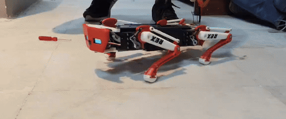
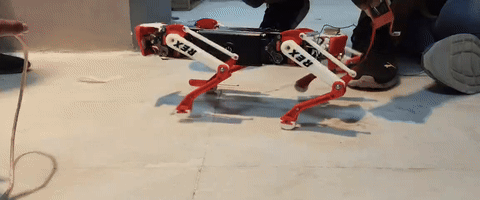
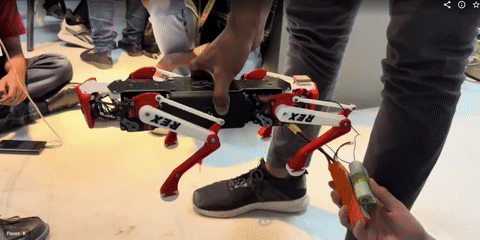
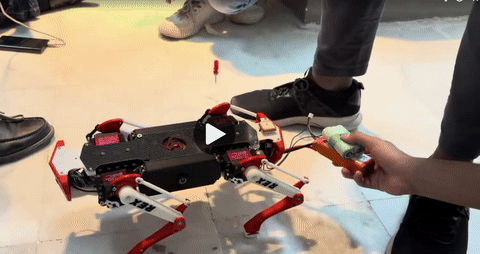

# rex-robo_dog 🐕

[](LICENSE)
[](https://docs.ros.org/en/humble/)
[](docker/)
[](https://www.raspberrypi.com/)
[](quad_ws/src/quad_main/)
[](quad_ws/src/quad_motors/)

> **Status:** 🟡 Development — Frame v2.2 is being tested and nearly ready for replication.

A 12-DOF quadruped robot dog running **ROS2 Humble in Docker** on a **Raspberry Pi 4/5**. Controlled via **PS4/PS5 controller** with linked-leg inverse kinematics and Bezier curve gait generation.

---

## 🎬 Watch rex-robo_dog Walk

See rex-robo_dog in action below:

| Walking demo 1 | Walking demo 2 |
|:---:|:---:|
|  |  |

| Walking demo 3 | Walking demo 4 |
|:---:|:---:|
|  |  |

> 💡 Add your own walking demo: place an MP4 at `assets/walking-N.mp4` and a GIF version will display here automatically.

---

## ✨ Features

| Feature | Description |
|:---|:---|
| 🦾 **12-DOF Actuation** | 3 RC servos per leg (hip, upper, lower) driven by **PCA9685** I2C PWM driver at `0x40` |
| 🧠 **Inverse Kinematics** | Linked-leg IK for Spot-Mini-Mini-style quadruped kinematics |
| 🦶 **Bezier Gaits** | Smooth walking gaits generated via Bezier curves |
| 🎮 **Gamepad Control** | PS4/PS5 teleoperation (USB or Bluetooth) via `sensor_msgs/Joy` |
| 🔧 **Servo Calibration** | Per-servo calibration tool with YAML persistence |
| 🖥️ **PyBullet Simulation** | Physics simulation environment and Gym interface |
| 📦 **Dockerized** | ROS2 Humble in Docker on Raspberry Pi OS host |
| 🔋 **Custom Hardware** | Expansion board + 8×18650 battery board with onboard BMS |

---

## 🏗️ Repository Structure

```
rex-robo_dog/
├── assets/                          # Media (walking GIFs, photos, etc.)
│   ├── walking.gif                  # Walking demo 1
│   ├── walking-2.gif                # Walking demo 2
│   ├── walking-3.gif                # Walking demo 3
│   └── walking-4.gif                # Walking demo 4
├── docker/                          # Docker image, compose file, run script
│   ├── Dockerfile                   # ROS2 Humble container image
│   ├── docker-compose.yml           # Multi-service composition
│   ├── run.sh                       # Container entrypoint
│   └── README.md                    # Docker-specific instructions
├── quad_ws/                         # ROS2 workspace (main codebase)
│   └── src/
│       ├── quad_main/               # Commander, IK, gaits, joystick interpretation
│       ├── quad_motors/             # PCA9685 servo driver + calibration
│       ├── quad_gamepad/            # PS4/PS5 gamepad input node
│       ├── quad_interfaces/         # Custom ROS2 messages (JointAngles, Outputs)
│       ├── quad_simulation/         # PyBullet simulation + Gym env
│       ├── quad_urdf/               # URDF/Xacro robot description + RViz
│       ├── quad_sensors/            # IMU & foot-sensor handling
│       └── quad_output/             # LED / NeoPixel output control
├── scripts/                         # Standalone utility scripts
│   └── kinematics-simulation/       # Forward/inverse kinematics tests
├── LICENSE                          # MIT License
└── README.md
```

---

## 🚀 Quick Start (Raspberry Pi)

### 1. Install Raspberry Pi OS

Install **Raspberry Pi OS (Bookworm, 64-bit)** and enable I2C:

```bash
sudo raspi-config   # Interfacing Options → I2C → Enable
```

Verify the PCA9685 is detected at `0x40`:

```bash
sudo i2cdetect -y 1
```

### 2. Install Docker

```bash
sudo apt update
curl -fsSL https://get.docker.com | sh
sudo usermod -aG docker $USER   # log out and back in
sudo apt install -y docker-compose-plugin
```

### 3. Clone and Build

```bash
git clone --filter=blob:none --sparse https://github.com/sam-black007/rex-robo_dog.git
cd rex-robo_dog && git sparse-checkout set quad_ws scripts docker
docker compose -f docker/docker-compose.yml build
docker compose -f docker/docker-compose.yml run --rm rex-robo_dog-ros2 \
  bash -c "source /opt/ros/humble/setup.bash && cd /workspace/quad_ws && colcon build"
```

### 4. Run

Connect the PCA9685, servos, power, and a PS4/PS5 controller (USB or Bluetooth), then:

```bash
docker compose -f docker/docker-compose.yml run --rm rex-robo_dog-ros2
```

The `docker/run.sh` script sources ROS2, builds the workspace if needed, and launches `quad_main quad_live.launch.py`.

### 5. Servo Calibration

```bash
docker compose -f docker/docker-compose.yml run --rm rex-robo_dog-ros2 \
  bash -c "source /opt/ros/humble/setup.bash && cd /workspace/quad_ws/src/quad_motors/quad_motors && ./servo_calibration.py"
```

Calibration results are written to `quad_ws/src/quad_motors/config/servo_parameters.yaml` (persisted on the host).

---

## 🖥️ Running Locally (without Docker)

See `quad_ws/dev-notes/ros2-setup.txt` and `ros2-commands.txt` for native ROS2 Humble setup on desktop or the Pi.

---

## 📦 ROS2 Workspace Overview

| Package | Purpose |
|:---|:---|
| `quad_main` | Commander, inverse kinematics, Bezier/dingo gaits, joystick interpretation |
| `quad_motors` | Servo control node, PCA9685 driver, calibration tool |
| `quad_gamepad` | Gamepad node publishing `sensor_msgs/Joy` |
| `quad_interfaces` | Custom messages: `JointAngles`, `Outputs` |
| `quad_simulation` | PyBullet physics simulation + Gym environment |
| `quad_urdf` | URDF/Xacro robot description + RViz config |
| `quad_sensors` | IMU & foot-sensor handling |
| `quad_output` | LED / NeoPixel output control |

### Key Topics

| Topic | Message Type | Description |
|:---|:---|:---|
| `/joy` | `sensor_msgs/Joy` | Gamepad input |
| `/joint_angles` | `quad_interfaces/JointAngles` | Joint angle commands |

---

## 🔧 Hardware

| Component | Specification |
|:---|:---|
| **Computer** | Raspberry Pi 4 (4 GB/8 GB) or Raspberry Pi 5 |
| **Actuators** | 12× RC servos via PCA9685 I2C PWM driver (`0x40`) |
| **Controller** | PS4/PS5 (USB or Bluetooth) |
| **Power** | 8× 18650 battery board with onboard BMS |
| **Boards** | Custom expansion board |

---

## 📄 License

This project is released under the **MIT License** — see [LICENSE](LICENSE).

The simulation, kinematics, Bezier curves, and machine learning are largely based on **[spot_mini_mini](https://github.com/OpenQuadruped/spot_mini_mini)** (MIT, © 2020 Maurice Rahme), which is in turn based on [SpotMicroAI](https://spotmicroai.readthedocs.io/en/latest/). The frame and leg-linkage design was inspired by [Baris Alp's Kangel robot dog](https://grabcad.com/library/diy-quadruped-robot-1).

---

## 🌍 Communities

- **SpotMicroAI Discord:** https://discord.gg/m5fsENhT
- **Quadrupedalism:** https://quadrupedalism.com/

---

## 🏷️ About

**rex-robo_dog** — a 12-DOF quadruped robot dog. ROS2 Humble in Docker on a Raspberry Pi 4/5 (upgraded from Pi 3, migrated from ROS1). Joint hardware & software project.

### Topics

[docker](/topics/docker)[hardware](/topics/hardware)[kinematics](/topics/kinematics)[pca9685](/topics/pca9685)[quadruped](/topics/quadruped)[raspberry-pi](/topics/raspberry-pi)[robot-dog](/topics/robot-dog)[robotics](/topics/robotics)[ros2](/topics/ros2)[ros2-humble](/topics/ros2-humble)[software](/topics/software)
